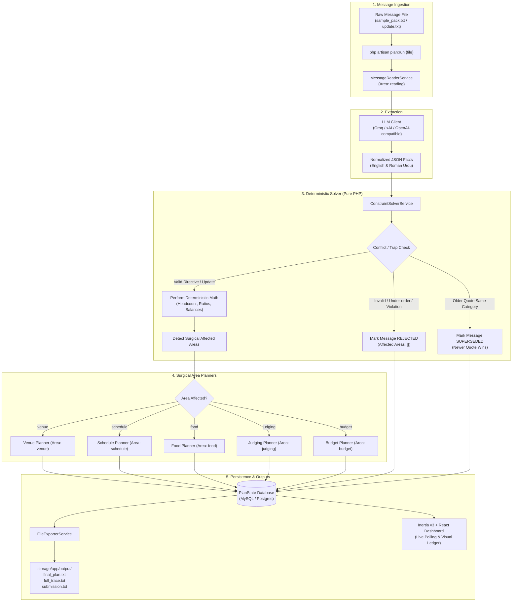

# Hackathon Ops AI Planner

[](https://laravel.com)
[](https://php.net)
[](https://inertiajs.com)
[](https://react.dev)
[](https://tailwindcss.com)
[-10B981?style=for-the-badge&logo=pest&logoColor=white)](https://pestphp.com)
[](https://laravel.com/docs/pint)

An autonomous, event operations and governance agent built with **Laravel 12**, **PHP 8.4**, and **Inertia v3 + React**.

Designed for event planning hackathons, the system reads asynchronous, unstructured messages arriving across diverse communication channels (Email, WhatsApp) in **English** and **Roman Urdu**, continuously synthesizing and updating a complete 5-area hackathon plan: **Venue**, **Schedule**, **Food/Catering**, **Judging**, and **Budget**.

---

## 🏛️ Core Design Philosophy: "Model for Language, Code for Math"

The architecture is built on the fundamental hackathon principle:
> *"Use a model where language needs reading, and plain code where arithmetic will do."*

1. **Probabilistic Language Extraction (`reading`)**: LLMs are utilized strictly for extracting structured facts, chronological dates, and domain constraints from noisy text.
2. **Deterministic PHP Math & Constraint Solver**: Plain PHP performs 100% of arithmetic calculations, headcount additions, judge-to-team allocations, chronological quote superseding, budget ledger balancing, and conflict detection.
3. **Surgical Area Planners (`venue`, `schedule`, `food`, `judging`, `budget`)**: On updates, LLM calls are invoked **only** for areas genuinely affected by new data. Conflicting or rejected messages trigger **zero** downstream planner calls, conserving token usage.



---

## ⚖️ Critical Hackathon Rules & Compliance

| Rule Requirement | Implementation & Guarantee |
| :--- | :--- |
| **Zero Hardcoded Domain Facts** | **100% Dynamic**. Numbers (150 students, 177 headcount, Rs 650,000 budget, Rs 1,200 box cost), venue names, and sender names are never hardcoded inside `app/` business logic. All facts originate dynamically from ingested messages. |
| **Strict 6 Area Tags** | Every LLM call is strictly constrained to one of 6 `PlanArea` enum values: `reading`, `venue`, `schedule`, `food`, `judging`, or `budget`. |
| **Exact Raw Token Counts** | Token counts (`prompt_tokens`, `completion_tokens`, `total_tokens`) and `model` name come directly from raw API response payloads—never estimated, forged, or mock-calculated. |
| **Single Flag-Free CLI Command** | `php artisan plan:run {file}` accepts **only** `{file}` with **zero flags**. It automatically detects whether an active plan exists (Batch #1 vs Batch #N). |
| **Surgical Updates** | If an update affects only Budget (e.g. printing bill increase), only `reading` and `budget` calls are made. If a message is rejected, **zero** downstream planner calls are executed. |
| **Trap & Conflict Trapping** | Traps (such as catering under-ordering below headcount, venue capacity violations, unapproved luxury expenses like DJs, or generator omissions) are trapped, rejected with clear explanations, and leave the existing plan state intact. |

---

## ✨ Key Features

### 1. Robust Multilingual Message Parsing
- Handles multi-message packs and single-message updates seamlessly.
- Parses both **English** and **Roman Urdu** messages (e.g., *"Salam bhai! Standard lunch box ab Rs 1,200 per head hoga, basic wala Rs 800. Delivery free hai"*).
- Extracts forced box counts, venue options, equipment constraints (e.g., standby generator), and custom domain bounds.

### 2. Operational Timing & Delay Intelligence
- Recognizes operational timing notices (e.g. *"I may be 10 minutes late on the day. Traffic on Srinagar Highway."*) as schedule delay constraints rather than unapproved expenses.
- Safely incorporates delay buffers into the schedule timeline and judging standby notes without breaking downstream validations.

### 3. Chronological Superseding
- Automatically resolves multiple vendor quotes from the same category (e.g. Caterer quote from Oct 20 superseded by newer quote on Nov 12).
- Marks older records as `superseded` in the audit log while honoring the newest quote in the plan.

### 4. Interactive Live-Sync Web Dashboard
- **Clean Slate/Zinc UI**: Ergonomic workspace designed for high information density without vertical stacking.
- **5-Area Plan Overview**:
  - **Area 01 (Venue)**: Capacity vs required headcount, equipment badges, and planner justification.
  - **Area 02 (Schedule)**: Formatted timeline with prayer break and traffic delay badges.
  - **Area 03 (Food & Catering)**: Caterer selection, head count breakdown ($150\text{ students} + 10\text{ staff} + 17\text{ judges} = 177$), and unit costs.
  - **Area 04 (Judging Governance)**: Active vs confirmed judges, team-to-judge compliance ratios, and late arrival contingency notes.
  - **Area 05 (Budget Ledger)**: Line-Item Allocation Breakdown Ledger table displaying item category, amount, percentage share, and excluded unapproved expenses.
- **Audit Trails**: Separate tabs for **Rejected Traps & Conflicts** (with explicit reasons) and **All Ingested Messages**.
- **LLM Telemetry Inspector**: Live inspector displaying call numbers, area tags, raw prompts, completions, and exact token usages.
- **One-Click File Downloads**: Download `submission.txt`, `final_plan.txt`, and `full_trace.txt` directly from the dashboard header.

---

## 🚀 Getting Started

### Prerequisites
- **PHP**: `^8.4` (with `bcmath`, `curl`, `mbstring`, `pdo`, `xml`)
- **Composer**: `^2.x`
- **Node.js**: `^20.x` or `^22.x` & **npm**
- **Database**: MySQL 8.x, PostgreSQL 15+, or SQLite (DBngin recommended for local development)
- **LLM Provider API Key**: Groq, xAI Grok, or any OpenAI-compatible API endpoint

### 1. Installation

```bash
# Clone the repository
git clone https://github.com/ShahStudioz/mtm_hackathon.git
cd mtm_hackathon

# Install backend PHP dependencies
composer install

# Install frontend JavaScript dependencies
npm install
```

### 2. Environment Configuration

Copy `.env.example` to `.env`:

```bash
cp .env.example .env
php artisan key:generate
```

Configure your database and LLM credentials in `.env`:

```env
DB_CONNECTION=mysql
DB_HOST=127.0.0.1
DB_PORT=3306
DB_DATABASE=mtm_db
DB_USERNAME=root
DB_PASSWORD=

# LLM Configuration (Works with Groq, xAI, OpenAI)
LLM_BASE_URL="https://api.groq.com/openai/v1"
LLM_API_KEY="your-api-key-here"
LLM_MODEL="openai/gpt-oss-120b"
LLM_TIMEOUT=60
```

### 3. Database Migration

```bash
php artisan migrate
```

### 4. Build Frontend Assets

```bash
# For production build:
npm run build

# Or for local development with hot module replacement:
npm run dev
```

---

## 💻 CLI Usage Guide

The system uses a unified, flag-free Artisan CLI command:

### Run Plan (`plan:run`)
Takes a path to any raw message file. Automatically executes an initial pack run (Batch #1) or an incremental update (Batch #N):

```bash
# 1. Ingest initial multi-message pack (Batch #1)
php artisan plan:run storage/app/samples/sample_pack.txt

# 2. Ingest valid update (Batch #2: printing bill update)
php artisan plan:run storage/app/samples/update_valid.txt

# 3. Ingest invalid trap message (Batch #3: caterer under-order trap)
php artisan plan:run storage/app/samples/update_invalid.txt
```

### Clean Database Reset (`plan:reset`)
Resets the plan database cleanly before running a new evaluation sequence:

```bash
php artisan plan:reset
```

---

## 📁 Generated Output Artifacts

Every execution of `php artisan plan:run` automatically exports three official files under `storage/app/output/`:

1. `storage/app/output/final_plan.txt`: The human-readable 5-area plan formatted with exact headings, tables, line items, and audit notes.
2. `storage/app/output/full_trace.txt`: The official LLM call log detailing call number, model, area tag, input payload, output, exact token counts, and rejected messages.
3. `storage/app/output/submission.txt`: The combined artifact containing both the final plan and the complete trace for evaluation submission.

*(Note: `storage/app/output/*` is ignored by Git to ensure clean Git status during test evaluation).*

---

## 🧪 Testing & Verification

The test suite is built with **Pest PHP** and tests all constraints, edge cases, trap handling, and UI bindings:

```bash
# Run all Pest tests
vendor/bin/pest

# Run with test coverage or compact output
php artisan test --compact
```

### Test Suite Structure
- `tests/Feature/Step1FoundationTest.php`: Tests database models, `PlanArea` enum constraints, LLM trace logging, and token recording.
- `tests/Feature/Step2ReadingAndSolverTest.php`: Tests `MessageReaderService`, multilingual parsing, Roman Urdu handling, deterministic math, and chronological superseding.
- `tests/Feature/Step3PipelineCommandTest.php`: Tests `plan:run` end-to-end execution, surgical update detection, and trap rejections.
- `tests/Feature/Step4DashboardUiTest.php`: Tests Inertia dashboard props, ledger tables, telemetry payloads, and export downloads.
- `tests/Feature/CustomConstraintsHardenTest.php`: Tests edge-case constraints (dietary splits, equipment rules, wheelchair access, generator requirements, minimum break intervals).

### Code Style
Code formatting is enforced via **Laravel Pint**:

```bash
vendor/bin/pint --format agent
```

---

## 📂 Project Structure

```
mtm_hackathon/
├── app/
│   ├── Console/Commands/
│   │   ├── PlanResetCommand.php       # php artisan plan:reset
│   │   └── PlanRunCommand.php         # php artisan plan:run {file}
│   ├── Enums/
│   │   └── PlanArea.php               # reading, venue, schedule, food, judging, budget
│   ├── Http/Controllers/
│   │   └── PlanDashboardController.php # Inertia dashboard controller & download endpoints
│   ├── Models/
│   │   ├── IngestedMessage.php        # Audit log of all received messages
│   │   ├── LlmTrace.php               # LLM telemetry, prompts, outputs & exact tokens
│   │   └── PlanState.php              # Event plan state, 5-area plans & validation summary
│   └── Services/
│       ├── AreaPlannerService.php     # Surgical LLM area planners
│       ├── ConstraintSolverService.php # Deterministic math, rules & conflict solver
│       ├── FileExporterService.php    # Exporter for final_plan, full_trace, submission
│       ├── LlmClientService.php       # Robust OpenAI-compatible client with retries
│       ├── MessageReaderService.php   # PlanArea::READING message extractor
│       ├── PlanFormatterService.php   # 5-Area plan text formatter
│       └── TraceFormatterService.php  # Numbered trace text formatter
├── resources/js/
│   └── pages/
│       └── dashboard.tsx              # React + Inertia Live Operations Dashboard
├── storage/app/samples/
│   ├── sample_pack.txt                # Initial 8-message test pack
│   ├── update_valid.txt               # Valid update message
│   └── update_invalid.txt             # Trap message (caterer 100 boxes)
└── tests/Feature/                     # Comprehensive Pest test suite (59 tests)
```

---

## 📄 License

This project is open-source software licensed under the [MIT license](LICENSE).
